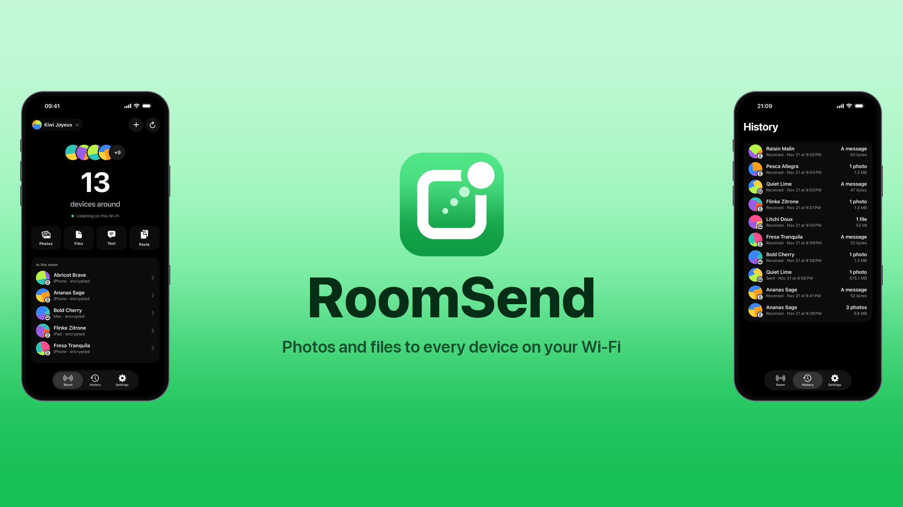
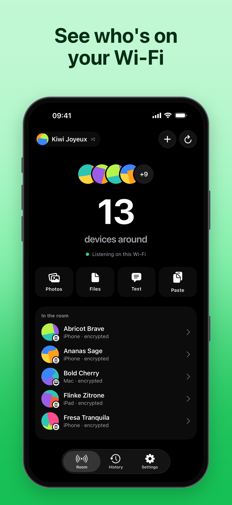
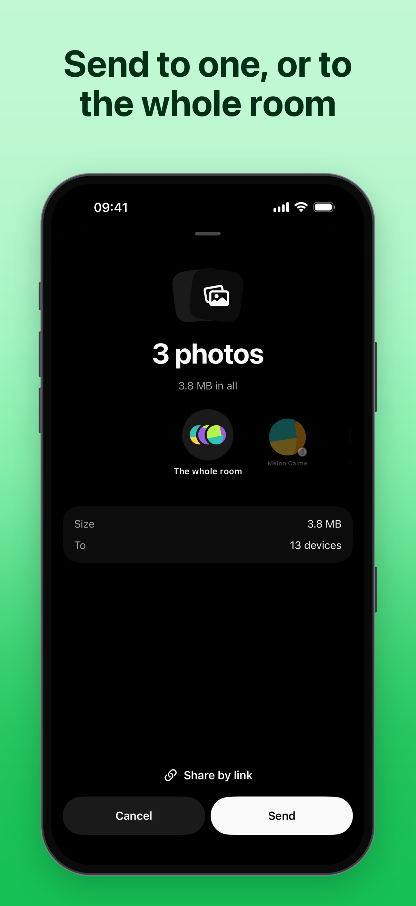
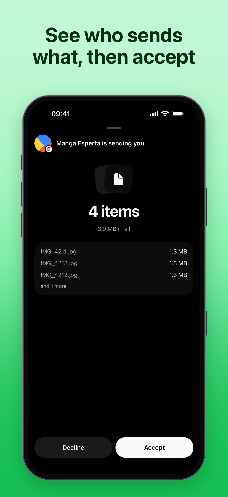
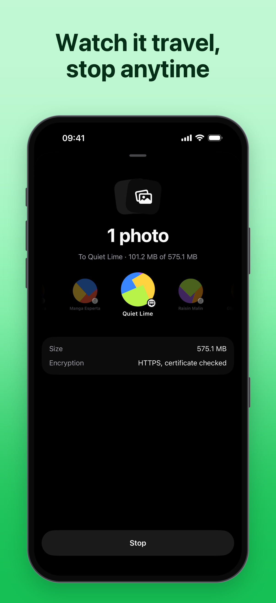
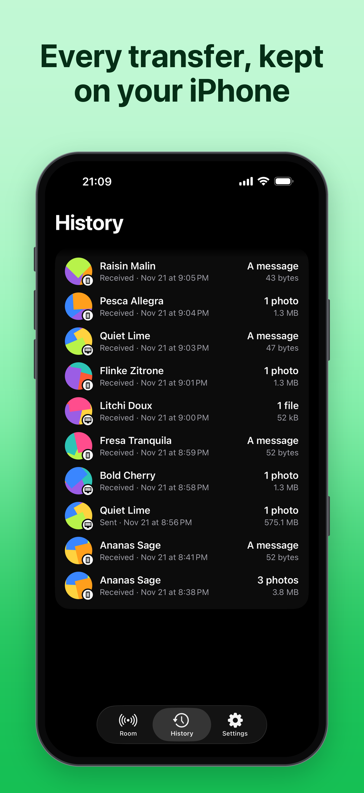
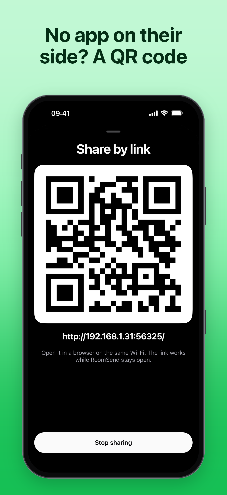
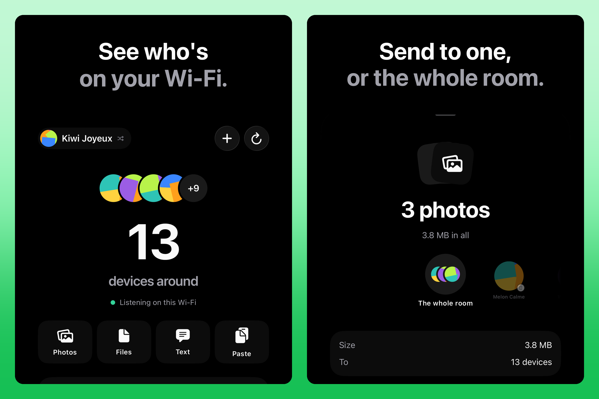
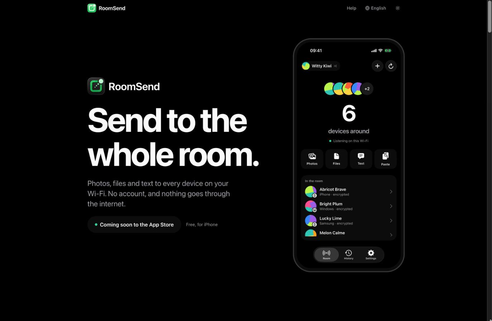
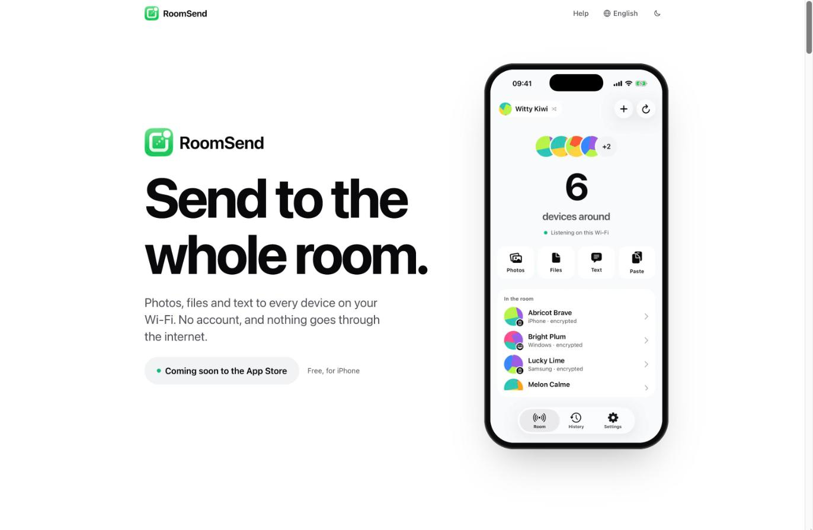

<p align="center">
  
</p>

<h1 align="center">RoomSend</h1>

<p align="center">
  A native iPhone app that sends photos, videos, files and text to the devices on your Wi-Fi.<br>
  No account, no server, no cloud. Compatible with <a href="https://localsend.org">LocalSend</a>.
</p>

<p align="center">
  <a href="https://roomsend.netlify.app">Website</a> ·
  <a href="https://roomsend.netlify.app/privacy">Privacy</a> ·
  <a href="docs/decisions.md">Design decisions</a> ·
  <a href="LICENSE">MIT License</a>
</p>

---

Open RoomSend and the room fills in. Every device running RoomSend, or any app that speaks the
LocalSend protocol (on iPhone, Android, Mac, Windows or Linux), appears with its name and its own
colored avatar. Tap a name, pick what to send, and watch it arrive.

<table>
  <tr>
    <td></td>
    <td></td>
    <td></td>
  </tr>
  <tr>
    <td></td>
    <td></td>
    <td></td>
  </tr>
</table>

## What it does

- **Send** photos, videos, files, a few words or what you just copied, to one device or to the whole
  room at once. Follow the progress in megabytes, and stop at any moment.
- **Receive** with a clear choice. You see who sends what, then accept or decline. Photos go to your
  library, files to the Files app, and a message opens with a Copy button. You can also accept
  automatically, or ask senders for a PIN.
- **Encrypted.** Transfers use HTTPS. Each device has its own certificate, and RoomSend checks that the
  device it talks to presents the fingerprint it announced. A device that doesn't encrypt is marked
  before you send anything.
- **Share by link** with someone who doesn't have the app. RoomSend shows a QR code that opens a
  download page in any browser on the same Wi-Fi, for as long as it stays open.
- **When the network blocks discovery,** RoomSend asks the local network address by address. You can
  also add a device by its IP. Your own address is shown in the same window, so two people can read
  each other's.
- **Favorites, history, share extension.** From Photos or any app, tap Share and pick RoomSend.
- **Six languages** (English, French, German, Spanish, Italian, Portuguese), switchable inside the
  app. Light and dark appearance.

## Private by design

RoomSend has no account and no server. Everything goes straight from one device to the other over
your local network. There is no analytics, no advertising and no tracking. Your name, your history
and your favorites stay on your iPhone.

## Works with LocalSend

RoomSend is an independent app that speaks version 2.2 of the open
[LocalSend protocol](https://github.com/localsend/protocol): discovery by multicast UDP on
`224.0.0.167:53317`, the `register`, `info`, `prepare-upload`, `upload` and `cancel` routes, HTTPS with
a SHA-256 certificate fingerprint, and PINs. It was written from the protocol's documentation; no line
of LocalSend's code is reused. RoomSend is not affiliated with the LocalSend project, whose apps are
excellent on every other platform.

## Design

The interface follows one rule, which the project calls the *living app*: every gesture shows its
result at once, on the real product. The room count grows as devices appear, the recipient in the
center of the carousel is the one who receives, and the history counts real bytes. The visual
direction mixes the clarity of banking apps such as Revolut with the friendliness of wallets such as
MetaMask, in light and dark. The interface itself stays neutral: its color comes from the devices,
each with its own avatar.

Each choice is recorded with its reasons in [`docs/decisions.md`](docs/decisions.md), and every bug
worth remembering in [`docs/lessons.md`](docs/lessons.md).

<p align="center">
  
</p>

## Build it

You need a Mac with Xcode 26 and [XcodeGen](https://github.com/yonaskolb/XcodeGen). The app targets
iOS 26.

```bash
git clone https://github.com/black-dash77/roomsend.git
cd roomsend
xcodegen generate
open RoomSend.xcodeproj
```

Set your own team in `project.yml` (`DEVELOPMENT_TEAM`), and your own bundle identifiers and app
group if you ship a fork. To test discovery and transfers, run RoomSend on two devices on the same
Wi-Fi, or next to LocalSend on any other device.

The interface strings live in Python tables and are compiled into the String Catalogs:

```bash
cd tools && python3 strings.py ../RoomSend/Resources
```

Two Swift packages are pulled in by Xcode:
[swift-certificates](https://github.com/apple/swift-certificates) and
[swift-asn1](https://github.com/apple/swift-asn1), both by Apple under Apache 2.0.

## What's in this repository

| Folder | Content |
|---|---|
| [`RoomSend/`](RoomSend) | The app, in SwiftUI and Swift 6: `Core` (design system, network, HTTP server, identity, localization) and `Features` (room, send, receive, history, settings, share link) |
| [`RoomSendShare/`](RoomSendShare) | The share extension |
| [`site/`](site) | The website: a static generator in Python, 4 pages in 6 languages, demos driven by real captures, the tools that capture them |
| [`appstore/`](appstore) | Everything for the App Store: name, subtitle, description and keywords in 6 languages, 6 screenshots per language at both required sizes, header and search visuals, review notes, privacy manifest |
| [`docs/`](docs) | The plan, the design decisions, the lessons learned, the icon source |
| [`tools/`](tools) | String tables, translations, and the legal texts shared by the app and the site |

## The website

[roomsend.netlify.app](https://roomsend.netlify.app) presents the app in six languages, with
interactive demos driven by real captures of the app: the room filling up as you drag a slider, the
recipient carousel, a transfer in progress, an offer to accept, light and dark side by side. Its
source is in [`site/`](site): a static generator in Python, a strict content security policy, no
cookies and no analytics.

<table>
  <tr>
    <td></td>
    <td></td>
  </tr>
</table>

```bash
cd site
python3 build.py
python3 tools/serve.py public 8766
```

## Status

Version 1.0 is ready and being prepared for the App Store. Until then, build it from source.

## Contributing

Issues and pull requests are welcome, especially bug reports from other LocalSend clients and
translations. Please keep the project's rules: one responsibility per file, no hard-coded values
outside the design tokens, and every visible string in all six languages.

## License

The code is released under the [MIT License](LICENSE). The name RoomSend and its icon identify the
official app, so please give your fork its own name and icon.
